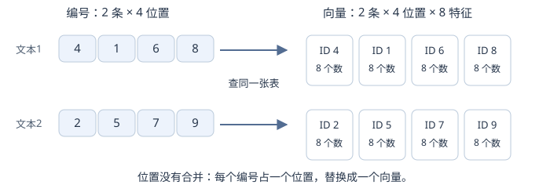

# 张量的三个维度

语言模型的一批 token 向量常用形状 `(B, T, D)` 表示。读懂这三个维度，就能区分文本条数、每条文本的位置数量和每个位置的向量长度。

这一章先建立读张量形状的方法：看到 (B, T, D)，能指出一个位置在哪里、它有多少个数，并分清输入数据和模型参数。

`B` 是一批中的文本条数，`T` 是每条文本的 token 数量，`D` 是每个 token 向量包含的数值数量。本篇先假设同一批中的文本长度相同。

## 从编号到向量

一条文本的 token 编号可以放在一个列表里，多条文本放在外层列表中。例如，以下数据有两条文本，每条四个 token：

```python
import torch

ids = torch.tensor([
    [4, 1, 6, 8],
    [2, 5, 7, 9],
])
embedding = torch.nn.Embedding(10, 8)
vectors = embedding(ids)
```

编号张量 `ids` 的形状是 `(2, 4)`。查表时，每个编号换成一个八维向量，所以 `vectors` 的形状是 `(2, 4, 8)`。词表大小 10 限定合法编号为 0 到 9。



横向是位置，外层两行是文本；每个输出格内部含 8 个特征。

图中的查表操作保留条数和位置数量，只为每个编号增加一个向量维度。同一个 token 在不同位置出现时，也分别占据一个位置。

## 数据形状与参数表

Embedding 的参数表形状是 `(10, 8)`，共有 80 个可训练数值。当前输出形状 `(2, 4, 8)` 则表示本批查表结果。同一个编号可以重复查同一行，批次变大不会自动扩充参数表。

只有一条文本且保留批次维度时，形状仍然有三项，例如 `(1, 5, 8)`。`(5, 8)` 只描述其中一条文本的向量矩阵。

## 小练习

一批有 3 条文本，每条 4 个 token，每个 token 的向量有 8 个数。这批向量张量的形状是什么？如果只把批次条数增加到 6，原有 embedding 参数表会随之变大吗？

### 参考答案

形状是 `(3, 4, 8)`。条数增加后，结果形状变为 `(6, 4, 8)`，但 embedding 参数表不变，因为各批次共用同一张表。

## 来源与复核状态

本篇由个人 Coral 笔记导出，技术内容待协作复核。来源版本见 [导入清单](../provenance.json)。参考的[社区课程笔记](https://github.com/narain1/stanford-cs336-2026-notes/tree/98492d17c0feaaf1ffbb9ecdc42154cd2349ae5e)不是课程官方材料；本篇为基础知识补充解释。
