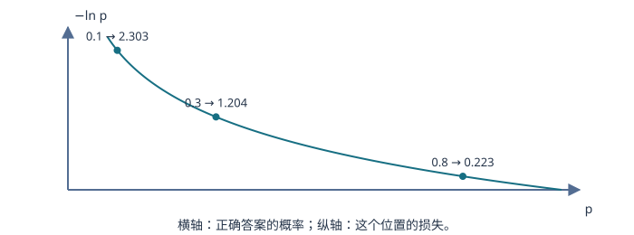

# 一个位置的交叉熵损失

训练时，实际答案已经由数据给出。模型要学习的，是把更高概率分配给这个答案。我们需要一个损失数值，把“答案得到的概率太低”转换成需要改进的程度；单位置交叉熵采用 $L=-\ln p$，其中 $p$ 是实际答案的概率。

这一章围绕一个预测位置，弄清答案概率怎样变成损失，以及为什么给正确答案的概率越低，损失越大。

前置知识：[按目标编号取出实际答案的概率](03-target-probability.md)。

## 先找到目标，再计算惩罚

假设三个 token 编号为 0、1、2，模型给出的概率为 [0.1,0.6,0.3]，训练目标是编号2。目标概率是0.3，虽然编号1的0.6更大，也不能拿它替代实际答案。

代入后，$L=-\ln(0.3)\approx1.204$。这里 $\ln$ 是自然对数。结果是这个预测位置的损失标量，不是概率或 token 编号。目标概率变成0.6时，损失降到约0.511；目标概率接近1时，损失接近0。

曲线显示同一条规则：正确答案概率越低，负对数损失越大；标注值为近似值。

横轴取的始终是实际答案概率。图上的下降趋势表示：提高这份概率，就会减小该位置受到的惩罚；它没有把“当前预测排名第一”作为评分条件。

## 负对数为什么适合衡量预测

概率在0到1之间，自然对数不大于0，加上负号后得到非负损失。目标概率越接近0，惩罚增长越大，使极度自信却错过实际答案的预测付出较大代价。

对一组给定上下文的目标，条件概率相乘后取负对数，等于各位置负对数相加。因此这条规则也能衔接到下一篇的多位置损失。求和是在合并评分，不是让模型把整段文字一次作为一个 token 预测。

公式要求 $0<p\leq1$。当 $p\to0$，损失趋于无穷大；不能给零概率指定一个普通的有限负对数值。实现中通常从原始分数直接稳定计算交叉熵，避免先得到极小概率再取对数产生数值问题。

如果对照原笔记里的 Python 表达，`math.log(p)` 对应 $\ln p$，前面的负号得到损失；使用前要加载 `math` 模块，直接对0调用会报错。这是公式的实现对应，不是本篇的学习要求。

## 自回归训练：哪个位置在预测哪个答案

单位置公式还需要正确对齐上下文与目标。输入token序列为[A,B,C,D]、logits布局为[B,T,V]时，位置i根据不晚于i的前缀预测token i+1：

| logits位置 | 可见前缀 | 目标 | 假设目标概率 | NLL |
| --- | --- | --- | --- | --- |
| 0 | A | B | 1/2 | ln2 |
| 1 | A,B | C | 1/4 | 2ln2 |
| 2 | A,B,C | D | 1/8 | 3ln2 |

没有额外EOS标签时，位置3无序列内下一个目标，不评分。三对整体平均为(ln2+2ln2+3ln2)/3=2ln2≈1.386294。这些概率是构造值，不是某个模型输出。

手写损失可用logits[..., :-1, :]与tokens[..., 1:]配对；logits[:-1]在[B,T,V]布局会误切batch维。若最后D其实是padding且该target被设为ignore_index，只剩前两项，平均(ln2+2ln2)/2=1.5ln2≈1.039721，分母从3变2。token ID为PAD并不自动变成ignore_index，必须明确构造label或loss mask；全无有效目标不能求空mean。

因果attention mask约束前向能读哪些位置，loss mask约束哪些预测项参加评分。两者不能互相替代：只屏蔽padding损失仍可能从未来位置泄漏答案；只用因果mask也不会自动删掉padding目标。同位置token作target则变成看到当前token后重建它，允许看对角线的因果mask不能纠正这个目标错误。

某些CausalLM封装在内部shift，接收的labels应与原tokens同长；手工先shift再交给它会错开两位。固定[Transformers v4.57.1 ForCausalLMLoss](https://github.com/huggingface/transformers/blob/v4.57.1/src/transformers/loss/loss_utils.py)默认将labels右侧pad为ignore_index再取[...,1:]，与忽略最后logit的配对等价。使用显式shift_labels或其他模型时应核对具体接口。

### EOS与不连续loss mask的对齐练习

输入[A,B,C,EOS]时，EOS是一个有意义的终止目标，不能因它位于末尾就自动删掉。假设只监督B与EOS，明确不监督C，则原始同长labels可写为[ignore,B,ignore,EOS]。内部shift后，四个logits位置分别对应[B,ignore,EOS,ignore]；手写shift时则保留前三个logits，对齐[B,ignore,EOS]。两种方式都只评分A→B与[A,B,C]→EOS，分母为2。

若这两项目标概率分别为1/2与1/8，平均损失为(ln2+3ln2)/2=2ln2。屏蔽C这个目标，不会从输入中删掉C；最后一项预测EOS时仍可读取C。若误将labels[2]的ignore当作“屏蔽logits位置2”，反而会删掉应监督的EOS，留下错位目标。这说明mask必须随目标一起shift，不能只在logits位置上凭同一个下标套用。

本节参考固定[PyTorch v2.9.0 CrossEntropyLoss](https://github.com/pytorch/pytorch/blob/v2.9.0/torch/nn/modules/loss.py)和[attention文档源码](https://github.com/pytorch/pytorch/blob/v2.9.0/torch/nn/functional.py)。B起草next-token配对、padding与内部shift说明，A补写EOS和不连续loss mask练习；已阅读固定实现并复核对齐和ln2算例，未运行语言模型训练。相关[问答#16](https://github.com/lw-liuwang/cs336-notes/discussions/16)，新增段落的核对不表示全篇原始材料已完成复核。

## 小练习

模型给实际答案的概率从0.3提高到0.6。损失变大还是变小？如果另一个候选的概率更高，计算这个训练目标的损失时需要换成它吗？

### 参考答案

损失变小：从约1.204降为约0.511。不换目标；损失始终使用实际答案的概率，更高的其他候选概率不能替代它。

## 来源与复核状态

本篇由个人 Coral 笔记导出，技术内容待协作复核。来源版本见 [导入清单](../provenance.json)。参考的[社区课程笔记](https://github.com/narain1/stanford-cs336-2026-notes/tree/98492d17c0feaaf1ffbb9ecdc42154cd2349ae5e)不是课程官方材料；本篇为基础知识补充解释。
