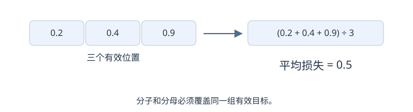

# 多个位置的平均损失

一段训练文本有多个预测位置，每个位置都能算出一个损失。为了用一个数代表这组预测，可以把参与训练的位置损失相加，再除以有效位置数。平均损失随后通过反向传播，合并这些位置对参数的影响。

这一章要弄清：哪些位置参与平均、分母为什么是有效位置数，以及这一个平均损失怎样汇总多处预测。

前置知识：[一个位置的交叉熵损失](04-single-token-loss.md)。

## 分子和分母要对应同一组目标

假设三个有效预测位置的损失为 [0.2,0.4,0.9]，每个位置等权。它们是已经算好的三个损失，不是同一位置三个候选 token 的概率。求和得到1.5，除以位置数3，平均损失为0.5。

每个位置等权；平均得到一个标量，并没有减少预测位置数量。

每个位置只贡献一个损失。训练可以对这个平均标量求梯度，不必为每个位置各更新一次参数。求平均中的除法也会传给梯度：平均三个损失，就是平均它们对同一参数的梯度贡献，前提是这些贡献在同一组参数上计算。

如果有填充位置或明确忽略的目标，它们的损失不进入分子，位置数也不进入分母。只扩大分母而不加入相应损失，会人为压低平均值。当前例子没有忽略位置，所以三个数全部参与。

## 平均选择了什么计数单位

本篇按有效 token 位置等权。文本长度不同时，一篇有2个有效位置、另一篇有8个，直接合并应除以10；先分别求每篇平均、再把两篇平均值等权平均，则让两篇各占一半，回答的是另一种权重设定。比较损失时应保持计数单位一致。

与原笔记的 Python 表达对应，`sum(losses)` 求出1.5，`len(losses)` 给出3，二者相除得到0.5。浮点结果有时显示成0.4000000000000001这类近似值，不表示平均规则改变。

## 小练习

三个有效位置的损失为0.2、0.4、0.6，另外两个填充位置不参与训练。平均损失是多少，分母应为3还是5？

### 参考答案

平均损失为 $(0.2+0.4+0.6)/3=0.4$。分母为3，填充位置既不贡献损失，也不计入有效位置数；除以5会把损失错误地压低。

## 来源与复核状态

本篇由个人 Coral 笔记导出，技术内容待协作复核。来源版本见 [导入清单](../provenance.json)。参考的[社区课程笔记](https://github.com/narain1/stanford-cs336-2026-notes/tree/98492d17c0feaaf1ffbb9ecdc42154cd2349ae5e)不是课程官方材料；本篇为基础知识补充解释。
