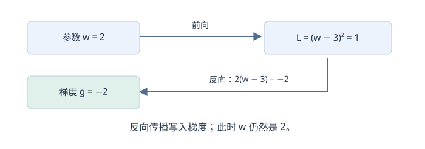

# 反向传播计算梯度

反向传播根据参数怎样影响中间结果、中间结果又怎样影响损失，沿计算依赖反向求出各参数的梯度。它回答的是“参数稍微变化，损失往哪边变”，并不直接修改参数。PyTorch 的 `loss.backward()` 对应这项工作，求得的梯度保存在参数的 `.grad` 中。

这一章跟着一个参数追踪梯度的来处，分清“算出参数该往哪边改”和“实际把参数改掉”两个步骤。

前置知识：[多个位置的平均损失](05-mean-loss.md)。

## 追踪参数与损失的关系

先用一个参数和平方损失观察反向传播。这里的平方损失用于演示自动求梯度，不是语言模型的交叉熵损失。这个例子从参数到损失都用 PyTorch 张量计算，以便自动追踪计算关系；前面用普通列表和 math 模块的例子用于理解损失的数值。

```python
import torch

w = torch.tensor(2.0, requires_grad=True)
loss = (w - 3) ** 2

loss.backward()

print(w.grad)
print(w)
```

`2.0` 是浮点数写法。`requires_grad=True` 告诉 PyTorch：需要追踪涉及 `w` 的计算，以便之后计算梯度。`** 2` 表示平方，所以当前损失是：

$$
(2-3)^2=1
$$

执行 `loss.backward()` 后，PyTorch 根据这段计算关系求出梯度，并保存到 `w.grad`。程序输出：

```text
tensor(-2.)
tensor(2., requires_grad=True)
```

第一行说明梯度为 `-2`；第二行说明参数 `w` 仍然是 `2`。暂时不用推导这个导数，只需要把梯度的符号和之前学过的方向联系起来：在当前位置附近，增大 `w` 可以降低损失。

## 梯度与参数值

下面的图区分前向计算、反向求梯度和参数数值：



箭头表示计算依赖和反向求导的方向；求梯度本身不执行参数更新。

前向计算建立参数与损失之间的关系，反向传播沿着这段关系计算梯度。`w.grad` 保存损失对参数的梯度，不是调整后的参数值。更新参数还需要后续的优化器步骤。

平方损失的梯度是 $2(w-3)$，所以在 $w=2$ 时为−2。负号表示在附近把参数稍微增大，损失趋向减小；它不是在说把参数直接改成−2。梯度描述局部趋势，具体移动多远仍由后面的更新规则决定。

## 小练习

已经完成反向传播，算出了梯度，但还没有执行优化器更新。此时 `w` 的数值是 `2`，还是已经变成 `3`？

### 参考答案

仍然是 `2`。

反向传播只算出了梯度 `-2` 并保存到 `w.grad`。尚未执行参数更新，因此 `w` 的数值保持不变。

## 来源与复核状态

本篇由个人 Coral 笔记导出，技术内容待协作复核。来源版本见 [导入清单](../provenance.json)。参考的[社区课程笔记](https://github.com/narain1/stanford-cs336-2026-notes/tree/98492d17c0feaaf1ffbb9ecdc42154cd2349ae5e)不是课程官方材料；本篇为基础知识补充解释。
