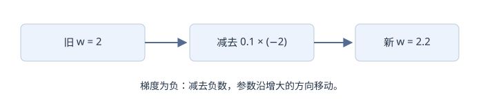
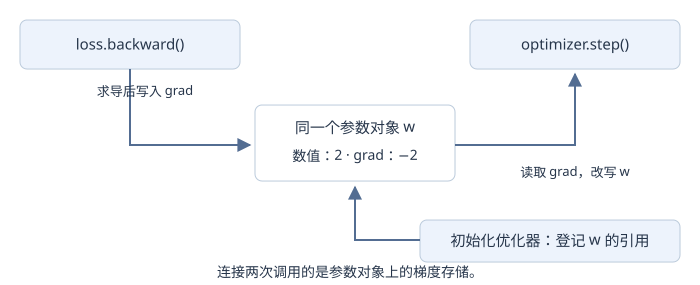

# 用 SGD 执行一次参数更新

反向传播算出梯度后，优化器使用梯度修改参数。对于最基本的梯度下降，更新规则是“新参数 = 旧参数 − 学习率 × 梯度”。

读完这一章，你应能用旧参数、梯度和学习率算出一次新参数，并找到 backward 与 step 在程序里怎样交接。

前置知识：[反向传播计算梯度](06-backward-gradient.md)。

## 梯度决定方向，学习率决定幅度

梯度为正，说明附近增大参数会使损失上升，就沿减小参数的方向移动；梯度为负，则沿增大参数的方向移动。这就是为什么要“减去”梯度。梯度描述局部趋势，学习率太大仍可能跨过较好区域，因此不能保证任意步长都降低损失。

PyTorch 的 `SGD` 优化器在默认不启用动量、权重衰减等额外选项时，可以执行基本的梯度下降更新。下面从一个新建的参数 `w = 2` 开始，完整执行一次计算和更新：

```python
import torch

w = torch.tensor(2.0, requires_grad=True)
optimizer = torch.optim.SGD([w], lr=0.1)

loss = (w - 3) ** 2
loss.backward()
optimizer.step()

print(w)
```

`[w]` 是交给优化器更新的参数列表。这个例子只有一个参数，所以列表中只放 `w`。`lr` 是学习率，`lr=0.1` 设置每次更新的调整尺度。

执行 `loss.backward()` 后，`w.grad` 为 `-2`，但 `w` 仍然为 `2`。接着，`optimizer.step()` 使用这个梯度执行更新：

$$
w_{\text{new}}=2-0.1\times(-2)=2.2
$$

因此，代码输出：

```text
tensor(2.2000, requires_grad=True)
```

本例用平方损失演示参数更新。参数更新与反向传播的分工，同样适用于后面语言模型的训练。

## 真正修改参数的步骤

一个参数在两步操作中的变化如下：



本图是学习率 0.1 的独立更新示例。

创建优化器不会立即修改参数。反向传播负责计算梯度，执行 `step()` 才会使用梯度更新参数。

## backward 与 step 通过参数的 grad 交接

创建优化器时，`torch.optim.SGD([w], lr=0.1)` 让它记住要更新的参数对象 `w`。优化器持有这个参数的引用，所以之后读取的也是同一个参数上的 `w.grad`。

计算 `loss = (w - 3) ** 2` 时，PyTorch 记录损失与 `w` 之间的计算关系。`loss.backward()` 沿这段关系计算梯度，并将结果累积保存到 `w.grad`。随后，`optimizer.step()` 遍历先前交给它的参数，读取各自的 `.grad`，按更新规则修改参数。



箭头表示读写或引用关系；step 不会重新调用 backward。

这两句通过保存在参数上的梯度交接信息，不是 `step()` 自动调用 `backward()`，也不是由 `backward()` 把梯度作为返回值传给下一行。

下面的代码可以观察这次交接。每个注释给出对应时刻的数值：

```python
import torch

w = torch.tensor(2.0, requires_grad=True)
optimizer = torch.optim.SGD([w], lr=0.25)

loss = (w - 3) ** 2
loss.backward()
print(w.grad)  # tensor(-2.)：梯度已保存
print(w)       # tensor(2., requires_grad=True)：尚未更新

optimizer.step()
print(w)       # tensor(2.5000, requires_grad=True)：已使用梯度更新
```

这里的 `lr=0.25` 是另一个从 `w=2` 开始的独立例子。`w` 保存参数值，`w.grad` 保存梯度，二者的作用不同。

## 小练习

重新从参数 `w = 2` 开始，已算出的梯度是 `-2`。如果将学习率设为 `0.25`，执行一次更新后，参数是多少？

### 参考答案

参数变成 `2.5`，因为 $2 - 0.25 \times  (-2) = 2.5$。

本题从原始参数 `2` 开始计算，不是在前一个例子的 `2.2` 上继续更新。

## 来源与复核状态

本篇由个人 Coral 笔记导出，技术内容待协作复核。来源版本见 [导入清单](../provenance.json)。参考的[社区课程笔记](https://github.com/narain1/stanford-cs336-2026-notes/tree/98492d17c0feaaf1ffbb9ecdc42154cd2349ae5e)不是课程官方材料；本篇为基础知识补充解释。
