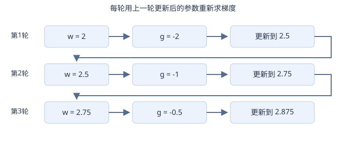

# 训练循环与连续更新

一次参数更新结束后，模型还没有学完。下一批数据要使用更新后的参数，再计算预测、损失和梯度；把这个过程重复，才形成训练。每轮都重新求梯度，因为参数移动后，损失的局部变化趋势也可能改变。

读完这一章，你应能沿连续两次更新追踪参数变化，分清每轮重算的结果和需要延续的状态，并区分训练步与 epoch。

前置知识：[清除旧梯度](08-zero-grad.md)。

## 下一轮从新参数出发

沿用一个参数的平方损失：$L=(w-3)^2$，梯度为 $g=2(w-3)$。初始 $w=2$，学习率为 0.25。第一轮得到梯度−2，更新到2.5；第二轮必须代入2.5重新求梯度−1，才能更新到2.75。继续使用第一轮的−2，就没有按当前参数求梯度。

L=(w−3)²，学习率 0.25；每轮先清旧梯度。箭头表示本轮计算及新参数传入下一轮。

箭头表示新参数交给下一轮。这个例子中每步离目标3更近，但真实语言模型的损失不是这条简单曲线，单次更新不保证每批损失都下降。

## 哪些操作重复，哪些状态延续

每轮先清除旧梯度，再用当前参数计算本轮损失，反向传播得到本轮梯度，最后更新参数。参数和优化器只在开始时创建；更新后的参数，以及 Adam 等优化器的历史状态，要延续到下一轮。清梯度不会把它们重置。

在程序中，`for` 只是重复这些操作的工具。`range(3)` 提供编号0、1、2，执行三轮；改为`range(5)` 就执行五轮。Python 用缩进标记循环里要重复的指令。理解训练时更关键的是：初始化留在循环外，四项训练操作放在循环内。

这里的一轮指一次参数更新。一个 epoch 则表示按约定遍历一遍训练集，两者不能混为一谈。

## 小练习

第一轮从 $w=2$ 更新到2.5后，下一轮能否继续沿用梯度−2？若一共重复五轮，并且每轮更新一次，最后执行了几次参数更新？

### 参考答案

不能沿用。下一轮应在新参数2.5处重新计算梯度，得到 $2(2.5-3)=-1$。五轮共更新五次；重复的次数不意味着参数每轮都从2重新开始。

## 来源与复核状态

本篇由个人 Coral 笔记导出，技术内容待协作复核。来源版本见 [导入清单](../provenance.json)。参考的[社区课程笔记](https://github.com/narain1/stanford-cs336-2026-notes/tree/98492d17c0feaaf1ffbb9ecdc42154cd2349ae5e)不是课程官方材料；本篇为基础知识补充解释。
