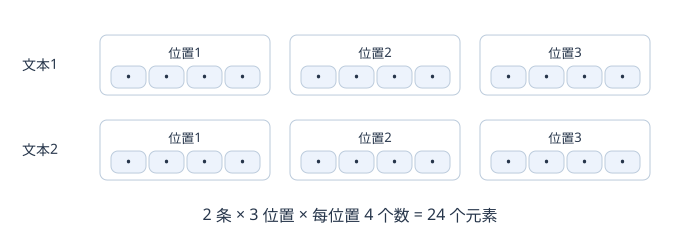

# 计算张量的元素数量

张量中的一个数称为一个元素。PyTorch 的 `numel()` 返回张量包含的元素总数，这是后面计算张量存储大小的基础。

读完这一章，你应能从各维长度算出元素总数，并分清维度个数、某一维的长度和整个张量包含多少个数。

前置知识：[张量的三个维度](00-foundations.md)。

## 将各维度长度相乘

对于形状为 `(2, 3, 4)` 的张量，可以理解为两条文本、每条三个 token、每个 token 用四个数表示。因此，元素总数是 $2 \times  3 \times  4 = 24$。

用 PyTorch 可以直接得到这个数量：

```python
import torch

x = torch.zeros(2, 3, 4)

print(x.shape)
print(x.numel())
```

输出为：

```text
torch.Size([2, 3, 4])
24
```

`torch.zeros(2, 3, 4)` 创建指定形状的张量，并将所有元素填为零。虽然这些数的值相同，但每个位置上的零仍然分别算一个元素。



每个小点表示一个数；数值即使相同，也分别占据一个元素位置。

图中先计算 token 位置总数，再乘每个位置的向量长度，得到整个张量包含的数值数量。

## 元素数量与形状

`x.shape` 描述各个维度的长度，`x.numel()` 返回所有元素的总数。对于 `(2, 3, 4)`，结果是 `24`，不是维度数量 `3`，也不是最后一维的长度 `4`。

元素数量只说明有多少个数，不能代替完整形状。例如，`(2, 3, 4)` 和 `(6, 4)` 都有 24 个元素，但排列结构不同。

## 小练习

一个张量 `x` 的形状是 `(3, 4, 5)`。它一共包含多少个数值元素？

### 参考答案

共有 `60` 个元素，因为 $3 \times  4 \times  5 = 60$。

需要将所有维度的长度相乘，才能得到整个张量的元素数量。

## 来源与复核状态

本篇由个人 Coral 笔记导出，技术内容待协作复核。来源版本见 [导入清单](../provenance.json)。参考的[社区课程笔记](https://github.com/narain1/stanford-cs336-2026-notes/tree/98492d17c0feaaf1ffbb9ecdc42154cd2349ae5e)不是课程官方材料；本篇为基础知识补充解释。
