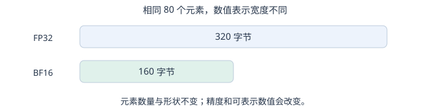

# 转换 dtype 后的存储变化

相同数量的元素使用不同存储格式时，所需的数据字节数可能不同。FP32 每个元素占 4 字节，BF16 每个元素占 2 字节。

读完这一章，你应能分别核算转换前后的张量，说明哪些量保持不变、哪些量改变，以及原张量是否仍占空间。

前置知识：[计算张量的元素数据大小](11-tensor-storage.md)。

## 转换存储格式

下面将一个 FP32 张量转换成 BF16：

```python
import torch

x = torch.zeros(2, 5, 8, dtype=torch.float32)
y = x.to(dtype=torch.bfloat16)
```

`x.to(dtype=...)` 返回指定格式的转换结果。本例把结果保存为 `y`，原来的 `x` 仍然是 FP32，没有被自动改写。

转换前后，形状和元素数量保持不变。变化的是每个元素的存储格式及所需字节数：

| 对象 | 形状 | 元素数量 | 每元素字节数 | 元素数据大小 |
|---|---|---:|---:|---:|
| x：FP32 | (2, 5, 8) | 80 | 4 | 320 字节 |
| y：BF16 | (2, 5, 8) | 80 | 2 | 160 字节 |

转换关系如下：



条长采用同一字节尺度；格式转换生成的近似值不保证与原值完全相同。

图中的转换没有减少元素数量，而是减少每个元素占用的字节数。BF16 的数值表示精细程度低于 FP32，实际训练还需要考虑数值稳定性。

这里的 160 字节只表示 `y` 的元素数据大小。示例仍保留 `x`，因此不能把它当作整个程序或训练过程的总内存。

## 小练习

另一个 FP32 张量有 100 个元素，将它转换为 BF16 并保存为 `y` 后：

1. 转换后还有多少个元素？
2. `y` 的元素数据占多少字节？

### 参考答案

仍有 `100` 个元素。转换格式没有改变元素数量。

BF16 每个元素占 2 字节，所以数据大小是 $100 \times  2 = 200$ 字节。

## 来源与复核状态

本篇由个人 Coral 笔记导出，技术内容待协作复核。来源版本见 [导入清单](../provenance.json)。参考的[社区课程笔记](https://github.com/narain1/stanford-cs336-2026-notes/tree/98492d17c0feaaf1ffbb9ecdc42154cd2349ae5e)不是课程官方材料；本篇为基础知识补充解释。
