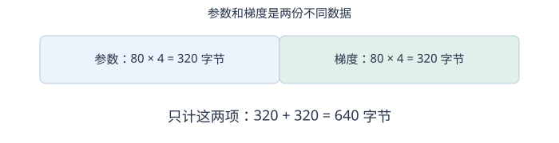

# 参数与梯度的存储小计

训练不仅需要存储模型参数，还可能需要保存反向传播算出的梯度。参数值和梯度是不同的数据，计算存储时要分别计入。

读完这一章，你应能给参数和已保存梯度分别记账，算出两项小计，并知道这还没有覆盖整个训练的存储。

前置知识：[计算张量的元素数据大小](11-tensor-storage.md)、[反向传播计算梯度](06-backward-gradient.md)。

## 分别计算两项数据

假设模型只有一个不含偏置的线性层：

```python
linear = torch.nn.Linear(8, 10, bias=False)
```

它有 $8 \times  10 = 80$ 个参数。本例假设所有参数都参与训练，梯度已经算出并保存，每个参数对应一个梯度数值，而且参数和梯度均采用 FP32 格式。

FP32 每个元素占 4 字节，因此：

| 数据 | 元素数量 | 每元素字节数 | 数据大小 |
|---|---:|---:|---:|
| 参数 | 80 | 4 | 320 字节 |
| 梯度 | 80 | 4 | 320 字节 |
| 两项小计 | 160 | 4 | 640 字节 |

梯度不是已经包含在参数数值中的一部分，需要单独存储。两项相加为 $80 \times  4 + 80 \times  4 = 640$ 字节。



两块宽度按容量等比例绘制；梯度存在后，要把它与参数分别计入。

图中先分别计算参数数据和梯度数据，再把两项相加。只有在上述格式和梯度保存条件下，才能直接按这个例子计算。

这只是参数与梯度两项的元素数据大小。实际训练还需要保存中间结果等其他数据，不能把这项小计当作全部训练内存。

## 小练习

一个模型有 200 个 FP32 参数，已经保存了对应的 200 个 FP32 梯度。每个 FP32 元素占 4 字节，仅这两项数据共占多少字节？

### 参考答案

共占 `1600` 字节，因为 $200 \times  4 + 200 \times  4 = 1600$。

参数和梯度各占 800 字节，需要分别计算后相加。

## 来源与复核状态

本篇由个人 Coral 笔记导出，技术内容待协作复核。来源版本见 [导入清单](../provenance.json)。参考的[社区课程笔记](https://github.com/narain1/stanford-cs336-2026-notes/tree/98492d17c0feaaf1ffbb9ecdc42154cd2349ae5e)不是课程官方材料；本篇为基础知识补充解释。
