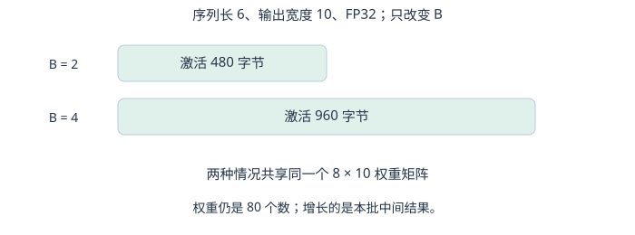

# 中间张量的存储与批次大小

前向计算产生的中间表示常称为激活张量。批次中的文本变多时，中间张量通常也会变大，但模型参数数量不因此改变。

读完这一章，你应能从输出形状算出一个激活张量的大小，并解释为什么增加批次条数会增加激活，却不增加权重数量。

前置知识：[参数与梯度的存储小计](13-parameter-gradient-storage.md)。

## 计算一个中间张量

下面的线性层将每个八维向量变成十维向量。在通常的默认 FP32 设置下：

```python
import torch

x = torch.zeros(2, 6, 8, dtype=torch.float32)
linear = torch.nn.Linear(8, 10, bias=False)
h = linear(x)
```

`h` 的形状为 `(2, 6, 10)`，包含 $2 \times  6 \times  10 = 120$ 个 FP32 元素，因此它的数据大小为 $120 \times  4 = 480$ 字节。

线性层仍然只有 $8 \times  10 = 80$ 个权重，各个文本和位置共享它们。



两条激活容量采用相同尺度；单个 h 的数据量不能代表整次训练的全部显存。

若把批次条数 `B` 从 2 增加到 4，`h` 的形状变为 `(4, 6, 10)`，数据大小增加到 960 字节，权重数量仍为 80。

## 按批次条数换算

480 字节已经包含 2 条文本，不能直接把它当成每条文本的大小。每条文本的输出数据是 $480 \div  2 = 240$ 字节，因此 3 条文本为 $240 \times  3 = 720$ 字节，5 条为 $240 \times  5 = 1200$ 字节。`480 × 3` 对应原来两条文本的三倍，也就是 6 条文本。

## 单个张量与训练存储

为了反向传播，模型通常还会保存一些中间信息；具体保存哪些取决于计算操作，不是每个输出都必须保留。

这里算的只是 `h` 自身的元素数据大小，不是全部激活数据或训练过程的内存峰值。

## eval模式与不记录梯度，控制的是两件事

预测时仍需要前向输出，但通常不需要为后续反向传播保存计算关系。`model.eval()`设置模块的训练状态；`torch.no_grad()`在上下文内关闭通常的反向图记录。前者不会自动关闭autograd，后者不会把模块自动切到eval模式。下面只讨论常规反向自动微分，不讨论forward-mode AD。

用一个标量参数$w=2$、输入$x=3$和`nn.Dropout(p=0.5)`构造$h=wx=6$、$y=dropout(h)$。假设$w.requires_grad=True$，其余没有显式detach或改变grad模式。训练时以各.5的概率输出0或$6/(1-.5)=12$，期望为6；eval时直接输出6。

| 模块状态 | 前向是否处于no_grad | 本例y | 是否记录本次参数乘法的反向关系 |
| --- | --- | --- | --- |
| train | 否 | 0或12，各.5 | 是 |
| eval | 否 | 6 | 是 |
| train | 是 | 0或12，各.5 | 否 |
| eval | 是 | 6 | 否 |

训练模式下若记录梯度，固定本次抽到的mask，对$w$的导数是0或$3/(1-.5)=6$；eval模式则为3。`eval()`下依然可以计算参数或输入梯度，这对分析预测敏感性有用。`no_grad()`下乘法不记录反向关系，不能期待事后退出上下文就从这次$y$恢复完整反向链；必须重新执行需要求导的前向。

表格比较的是**本例乘法的图记录**，不是说no_grad内任何对象的`requires_grad`一定为False。该上下文不重写原参数的属性，也不会清除之前已有的`.grad`；带`requires_grad`参数的工厂函数有例外，例如在上下文里创建`nn.Parameter`仍可要求梯度。它也不是释放所有内存的命令：参数、用户保留的输出及其他张量仍然存在。

回到本章线性层，若输入形状和dtype不变，前向结果`h`仍有120个FP32元素，即480字节。关闭图记录可以减少为反向保存的额外信息，但不能把这480字节说成0，也不能仅凭这个大小推出总显存节省比例。`eval()`是否改变前向行为则取决于模块；本例Dropout会改变，普通Linear不会仅因train/eval切换改变公式。

通常的预测过程同时需要`model.eval()`和`with torch.no_grad(): ...`；若刻意做随机dropout预测或需要梯度，则应按目标分别选择。函数式`F.dropout`使用其显式`training`参数（默认True），不会因为某个外部模块调用eval就自动知道该状态；自定义模块应把需要的`self.training`传入。

练习：同例只调用`eval()`，没有no_grad，令损失$L=y^2$。$L$和$\partial L/\partial w$是多少？答案：$y=6,L=36$；$2y\times x=36$。eval模式仍能构建这里的反向关系。

固定来源：PyTorch v2.9.0的[Module.eval实现](https://github.com/pytorch/pytorch/blob/v2.9.0/torch/nn/modules/module.py)、[autograd模式说明](https://github.com/pytorch/pytorch/blob/v2.9.0/docs/source/notes/autograd.rst)、[Dropout定义](https://github.com/pytorch/pytorch/blob/v2.9.0/torch/nn/modules/dropout.py)及[no_grad的工厂函数例外](https://github.com/pytorch/pytorch/blob/v2.9.0/torch/autograd/grad_mode.py)。本节由源码语义与标量算例推导，未运行PyTorch或测量内存峰值；原始章节复核状态保持原记录。

## 验证结束后，哪些状态会自动恢复

退出`no_grad`上下文会恢复进入前的grad模式，而不是无条件改成True；即使验证抛异常，正常上下文退出也会执行恢复。模块的eval状态则会保留，直到另外切换。需要恢复原来的训练模式时，两者要分别处理。

在各子模块原本采用统一模式、允许一起切换的前提下，可以写成以下最小顺序；该代码是教学示意，不是本机PyTorch运行记录：

```python
was_training = model.training
model.eval()
try:
    with torch.no_grad():
        prediction = model(inputs)
finally:
    model.train(was_training)
```

若进入前是普通训练模式，最终恢复train；若原来是eval，最终仍为eval。若外层早已关闭grad，内层no_grad退出后也保持关闭，不能只凭`was_training`推断grad模式。

顶层标志还不能表达混合子模块状态。例如顶层原为train，某个冻结统计量的子模块单独处于eval；验证后只调用`model.train(True)`会递归把这个子模块也改成train，和原状态不同。此时需保存各模块的模式并按其状态契约恢复。直接赋值training只恢复标志，不能保证覆盖自定义train方法的其他副作用，不应称为任意模块的通用恢复器。

A以PyTorch v2.9.0原`Module.train/eval`和`no_grad.__enter__/__exit__`方法、最小本地状态适配器核对异常退出、先前grad=False及混合模式反例；未创建PyTorch张量、运行autograd或测量显存。模式源码见前述固定来源，`train`递归子模块与no_grad保存/恢复prev是两个独立机制。

## 小练习

其他设置不变，把批次条数改为 `B = 3`。`h` 的元素数据有多少字节？线性层的权重数量会改变吗？

### 参考答案

`h` 的数据大小是 $3 \times  6 \times  10 \times  4 = 720$ 字节。

权重数量不变，仍为 80。增加批次条数会增加本批中间数据，不会增加该线性层的参数。

## 来源与复核状态

本篇由个人 Coral 笔记导出，技术内容待协作复核。来源版本见 [导入清单](../provenance.json)。参考的[社区课程笔记](https://github.com/narain1/stanford-cs336-2026-notes/tree/98492d17c0feaaf1ffbb9ecdc42154cd2349ae5e)不是课程官方材料；本篇为基础知识补充解释。
