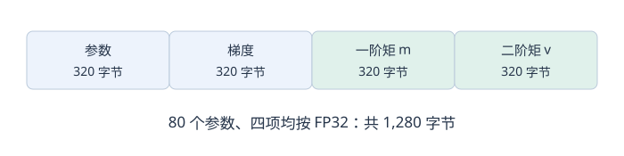

# 优化器状态的存储

优化器更新参数时，除了读取当前梯度，还可以保存梯度历史的统计信息。这些额外保存的数据叫作优化器状态，也需要计入存储。

这一章要弄清 Adam 额外保存了哪两组数，并把参数、梯度、优化器状态四项存储分别算清。

前置知识：[参数与梯度的存储小计](13-parameter-gradient-storage.md)。

## Adam 保存的两组状态

Adam 是另一种常用的优化器。它用两组状态辅助更新参数：一组记录梯度历史的平滑统计，另一组记录梯度平方历史的平滑统计。可以先理解为，更新时同时参考当前梯度和过去的变化情况。

每组状态的形状都与对应参数张量相同。因此，80 个参数各对应 80 个第一组状态数值和 80 个第二组状态数值。这些状态是另外保存的数据。

## 四项数据分别计算

假设参数、梯度和两组状态都已经保存，全部使用 FP32，每个元素占 4 字节。对于 80 个参数：

| 数据 | 元素数量 | 数据大小 |
|---|---:|---:|
| 参数 | 80 | 320 字节 |
| 梯度 | 80 | 320 字节 |
| Adam 第一组状态 | 80 | 320 字节 |
| Adam 第二组状态 | 80 | 320 字节 |

两组优化器状态合计 `640` 字节，四项合计 $320 + 320 + 320 + 320 = 1280$ 字节。

绿色两块是 Adam 的持久历史状态；例子不计激活、临时缓冲和混合精度主参数等。

图中两组状态是独立于参数和梯度的额外数据。本例只计算这四项，不包括中间结果、额外参数副本、标量等，也不是训练峰值内存。

## 状态是何时出现的：None和零梯度不相同

前面的四项账本假设状态已经建立。固定PyTorch v2.9.0普通Adam、amsgrad=False，从全新且未加载checkpoint的优化器开始，_init_group只处理grad is not None的参数；第一次处理某参数时才惰性创建step、exp_avg与exp_avg_sq。仅构造优化器并不立即为全部参数建立这两份矩。

构造两个独立的FP32 Parameter张量A、B，各40元素，共80个参数。只算权重、当前梯度及两份矩的数据，排除step标量、元数据、激活、临时缓冲和allocator：

| 阶段 | 参数字节 | 当前梯度字节 | 两份矩字节 | 小计 |
| --- | --- | --- | --- | --- |
| 刚构造，A/B.grad都None | 320 | 0 | 0 | 320 |
| 仅A收到40元素梯度并完成首次step | 320 | 160 | 320 | 800 |
| 随后zero_grad(set_to_none=True) | 320 | 0 | 320 | 640 |
| 只给B一个40元素零梯度张量并step | 320 | 160 | 640 | 1120 |
| 后续A/B均有梯度、状态已建立 | 320 | 320 | 640 | 1280 |

第三行清除了当前梯度引用，没有清掉A的矩；第四行B梯度数值虽为0，仍满足is not None，因此初始化B的状态。若weight_decay=0且B初始矩为零，该次自适应方向为零，却仍建立状态并推进B的step。A当次grad=None则跳过，A的step仍停在1；B的首次step也为1。这里没有共同的“所有参数都已更新两次”时钟。

若某参数已有矩，grad=None不让矩乘beta，也不执行该参数的weight decay；数值为零的梯度则进入更新路径，历史矩或衰减仍可能使参数移动。zero_grad(set_to_none=False)只清零已有梯度，不会为原来None的参数分配零张量，故不能据它推断下一次会初始化全部状态。

### 两个参数在同一次step里可以有不同的时间计数

另取两个标量A、B，初值均为1，设普通Adam的lr=.1、beta1=beta2=.5、weight_decay=0、amsgrad=False。为便于手算令eps=0；下面二阶矩均为正，这只是代数例子，不是建议在一般训练中移除稳定项。状态起初为空。

第一次调用step：A.grad=2、B.grad=None。A的m=1、v=2、step=1，偏差校正得到m_hat=2、v_hat=4，方向为1，故A=.9。B跳过，不建立状态，仍为1。

第二次调用step：A.grad=0、B.grad=2。A虽然损失梯度为零，旧矩仍更新为m=.5、v=1、step=2；校正分母均为1-.5²=.75，因此m_hat=2/3、v_hat=4/3，方向为1/sqrt(3)，A更新为.9-.1/sqrt(3)≈.8422649731。B则是首次参与，step=1，矩与校正和A的第一次相同，所以B=.9。不能把优化器全局调用次数2强行代入B的偏差校正。

如果第二次将A.grad改成None，A会保持.9，连m=1、v=2、step=1都保持，不会先让历史矩衰减。None与数值0的区别同时影响参数、矩和每参数时间计数；不能只比较这次新梯度是否为零。

本例FP32参数的矩使用zeros_like建立，因而同为FP32。不要把它升级为任意混合精度实现的通用16字节/参数规则：普通Adam状态dtype随参数路径而定，外部优化器可能使用主副本或不同状态格式；AMSGrad还增加max_exp_avg_sq。加载checkpoint可以预先恢复状态，foreach/fused也影响临时峰值。表格是明确假设下的持久数据账本，不是显存实测。

来源：[PyTorch v2.9.0 adam.py的_init_group与惰性初始化](https://github.com/pytorch/pytorch/blob/v2.9.0/torch/optim/adam.py)、[Optimizer.zero_grad](https://github.com/pytorch/pytorch/blob/v2.9.0/torch/optim/optimizer.py)。B起草惰性状态和320/800/640/1120/1280字节账本，A补写已有动量零梯度及每参数step不同的标量算例；已阅读固定源码并独立核对算术，未运行优化器或显存实验。全篇其他导入内容仍按原复核状态管理。

## 小练习

模型有 100 个参数，其他假设与例子相同。Adam 两组状态合计多少字节？参数、梯度及两组状态合计多少字节？

### 参考答案

两组状态合计 $100 \times  2 \times  4 = 800$ 字节。

四项数据合计 $100 \times  4 \times  4 = 1600$ 字节。

每组都有 100 个元素，两组优化器状态需要在参数与梯度之外另计空间。

## 来源与复核状态

本篇由个人 Coral 笔记导出，技术内容待协作复核。来源版本见 [导入清单](../provenance.json)。参考的[社区课程笔记](https://github.com/narain1/stanford-cs336-2026-notes/tree/98492d17c0feaaf1ffbb9ecdc42154cd2349ae5e)不是课程官方材料；本篇为基础知识补充解释。
