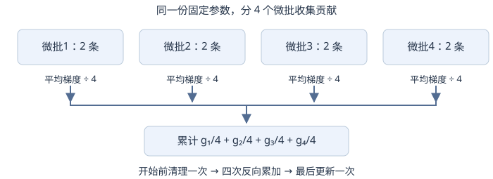

# 用梯度累积处理多个小批次

梯度累积是指：连续处理几个小批次，每批都计算梯度，但暂不更新参数；等这些梯度累加完成，再执行一次参数更新。

读完这一章，你应能排出四个小批次的前向、反向和一次更新，解释清梯度的位置与损失缩放为什么会影响结果。

前置知识：[清除旧梯度](08-zero-grad.md)、[训练循环与连续更新](09-training-loop.md)、[中间张量的存储与批次大小](14-activation-storage.md)。

## 四个小批次合成一次更新

假设每个小批次有 2 条文本，连续累积 4 批。这次更新共使用 $2 \times  4 = 8$ 条文本，执行 4 次 `backward()`，但只执行 1 次 `optimizer.step()`。

这里假设四批大小相同、每条文本的有效预测目标数量相同，且损失函数返回每批的平均损失。每批损失要先除以 4，使累积梯度对应这 8 条文本的整体平均，而不是四个平均损失之和。

下面的 `microbatches` 包含四批数据，每批提供输入 `micro_x` 和目标 `micro_y`。`model` 计算预测，`loss_fn` 计算该批的平均损失：

```python
optimizer.zero_grad()

for micro_x, micro_y in microbatches:
    loss = loss_fn(model(micro_x), micro_y) / 4
    loss.backward()

optimizer.step()
```

`optimizer.step()` 没有缩进，因此在四批数据处理完之后才执行。在这之前，各批前向计算使用同一组参数。

## 累加梯度，及时处理各批中间结果

`zero_grad()` 只在这一组小批次开始前调用。若每批都清除梯度，前面累积的结果就会丢失。



箭头表示梯度贡献汇入同一存储；等大小、等权有效目标下，得到八条样本的平均贡献。

图中每批都及时执行反向传播，不必同时保留四批所需的中间结果。这样能减少同时保存的中间数据，但参数、梯度和优化器状态并不会因为分批而减少。总的前向与反向计算也没有因此消失。

上述整体平均梯度的说明，适用于损失可按样本独立相加、模型计算也满足相应条件的情况。跨样本运算或随机计算等因素可能使分批与一次处理大批次的数值结果不同。

## 清梯度的位置与平均梯度

如果将 `zero_grad()` 放到循环内每批开始处，第 2 批会清掉第 1 批的梯度，第 3 批会清掉第 2 批的梯度。循环外的 `step()` 只能使用最后一批留下的梯度。把清梯度放在整组小批次之前，才会保留各批累积的梯度。

损失乘一个常数，相应梯度也乘这个常数。因此，两批原始梯度为 2 和 6 时，每批损失除以 2，累积结果为 $2 / 2 + 6 / 2 = 4$，对应两批的平均梯度。这个等权平均依赖各批大小及有效预测目标数量相同的假设。

## 小练习

每个小批次有 2 条文本，累积 3 批后再更新一次参数。共使用几条文本？反向传播和参数更新分别执行几次？

### 参考答案

共使用 `6` 条文本，执行 `3` 次 `backward()`、`1` 次 `optimizer.step()`。

每批都贡献梯度，但等三批梯度累积完成后才更新一次参数。若每批返回同权平均损失，本例相应将每批损失除以 3。


## 来源与复核状态

本篇由个人 Coral 笔记导出，技术内容待协作复核。来源版本见 [导入清单](../provenance.json)。参考的[社区课程笔记](https://github.com/narain1/stanford-cs336-2026-notes/tree/98492d17c0feaaf1ffbb9ecdc42154cd2349ae5e)不是课程官方材料；本篇为基础知识补充解释。
